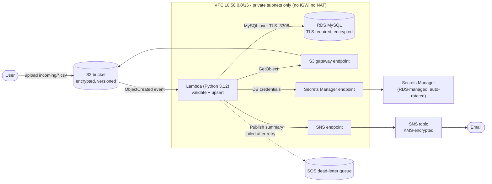

# Serverless Data Processing Pipeline (S3 → Lambda → RDS → SNS)

Upload an orders CSV to S3, and a few seconds later the rows are validated, loaded into a
**private MySQL database on Amazon RDS**, and you get an **email summary through SNS**.
Bad rows are skipped and listed in the email instead of failing the whole file.

The Lambda function runs inside a VPC that has **no internet gateway and no NAT gateway**.
It reaches S3, SNS and Secrets Manager only through VPC endpoints.

## Architecture



### What happens to each file

| Situation | Result |
|-----------|--------|
| All rows valid | Rows upserted, email with status **OK** |
| Some rows invalid | Valid rows loaded, email with status **PARTIAL** listing each bad row and why |
| File unusable (missing columns, not UTF-8, over 5 MB) | Nothing loaded, email with status **REJECTED** (no retry, since retrying can't fix it) |
| Database or network error | Email with status **FAILED**. Lambda retries once, then the event goes to the **dead-letter queue** |

Uploading the same file again **updates** rows rather than duplicating them
(`INSERT ... ON DUPLICATE KEY UPDATE`), so reprocessing is safe.

## Security measures

- **No internet path at all.** The VPC has no IGW or NAT. All AWS API traffic goes through VPC endpoints.
- **Endpoint policies** restrict what can pass through each endpoint, even for a compromised function:
  - S3: only `GetObject` on `incoming/*` of this bucket
  - SNS: only `Publish` to this topic
  - Secrets Manager: only this DB secret
- **IAM least privilege.** The function role can read `incoming/*`, read one secret, publish to one
  topic, and send to one queue. Nothing else.
- **No database password anywhere.** `ManageMasterUserPassword` makes RDS generate and rotate the
  password in Secrets Manager. The function fetches it at connect time.
- **Encryption in transit.** A DB parameter group sets `require_secure_transport = 1`, and the function
  verifies the RDS certificate against the AWS CA bundle (`ssl_verify_identity`). Bucket and topic
  policies deny non-TLS requests.
- **Encryption at rest:** RDS, S3 (SSE-S3), SNS (KMS) and SQS (SSE-SQS).
- **Confused-deputy protection.** The Lambda permission for S3 is scoped with `SourceArn` and `SourceAccount`.
- **Input validation.** Required columns, types, ranges, lengths, duplicate IDs, file size and row count
  are all checked, and every query is parameterized (no SQL injection).

## Repository layout

```
infrastructure/template.yaml   VPC, endpoints, RDS, SNS, SQS, Lambda, S3 (one stack)
src/app.py                     Lambda handler: S3 -> validate -> RDS -> SNS
src/csv_validator.py           Pure-Python validation (unit-tested)
src/requirements.txt           PyMySQL
tests/                         Unit tests for the validator
sample-data/                   A clean file and a file with deliberate errors
scripts/build.sh               Runs tests, builds build/package (code + PyMySQL + RDS CA bundle)
scripts/deploy.sh              Builds, packages and deploys the stack
```

## Deploy

Prerequisites: AWS CLI v2, Python 3.12+, Bash (Git Bash works on Windows).

```bash
NOTIFICATION_EMAIL=you@example.com ./scripts/deploy.sh serverless-pipeline
```

Then **confirm the SNS subscription** from the email AWS sends you.

## Test it

```bash
BUCKET=$(aws cloudformation describe-stacks --stack-name serverless-pipeline \
  --query "Stacks[0].Outputs[?OutputKey=='IncomingBucketName'].OutputValue" --output text)

# 1. Clean file -> "OK" email, 5 rows loaded
aws s3 cp sample-data/orders.csv s3://$BUCKET/incoming/orders.csv

# 2. File with mistakes -> "PARTIAL" email listing the 4 bad rows
aws s3 cp sample-data/orders-with-errors.csv s3://$BUCKET/incoming/orders-with-errors.csv

# 3. Watch the function work
aws logs tail <LogGroupName> --follow    # LogGroupName is a stack output
```

Example email for the second file:

```
File:            s3://serverless-pipeline-.../incoming/orders-with-errors.csv
Rows loaded:     2
Rows rejected:   4
Orders in table: 7

Rejected rows:
  - line 3: quantity 'two' is not a whole number
  - line 4: unit_price '-100' is out of range
  - line 5: customer_name is empty
  - line 6: order_date '06-11-2026' must be YYYY-MM-DD
```

Run the unit tests locally:

```bash
python -m unittest discover -s tests -v
```

## Clean up

```bash
aws cloudformation delete-stack --stack-name serverless-pipeline
```

The incoming bucket and the `serverless-pipeline-artifacts-...` bucket are kept. Empty them in the
S3 console and delete them if you don't need them.

## Cost notes

Lambda, SNS and SQS are effectively free at this volume, and RDS `db.t4g.micro` is free-tier eligible.
The **two interface endpoints cost about $0.02 per hour together**. They're placed in one subnet to
halve that. Delete the stack when you're done.

## What I'd change for production

- Multi-AZ RDS, RDS Proxy for connection pooling, and endpoints in every AZ
- A dedicated least-privilege DB user (or IAM database authentication) instead of the master user
- Move processed files to `processed/` and rejected ones to `rejected/`
- A CloudWatch alarm on the DLQ depth and on function errors
- Deploy through a CI/CD pipeline that runs the unit tests first

## Skills demonstrated

`AWS Lambda` `Amazon S3` `Amazon RDS (MySQL)` `Amazon SNS` `Amazon SQS` `AWS Secrets Manager`
`VPC endpoints` `IAM` `CloudFormation` `CloudWatch Logs` `Python` `SQL` `Unit testing`
